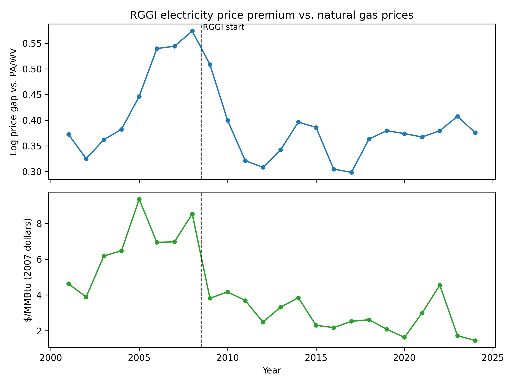

# Forecasts vs. Reality: Lieberman-Warner Permit Prices and Real Cap-and-Trade Markets

Comparing 2008 forecasts of the Lieberman-Warner Climate Security Act with actual permit prices and household costs in the EU Emissions Trading System, California, and the Regional Greenhouse Gas Initiative (RGGI).

**Full paper:** [Forecasts_vs_Reality.pdf](paper/Forecasts_vs_Reality.pdf)

## Key findings
- **Permit prices:** every program priced below the minimum 2008 forecast in both 2015 and 2020. Only the EU has since reached the 2030 forecast range.
- **Household costs:** at observed prices, expected effects on consumption and residential electricity prices were too small to detect in state-level data.
- **Natural gas:** RGGI's electricity price premium over Pennsylvania and West Virginia tracked natural gas prices (r = 0.64 in levels; r = 0.54 for changes with a one-year lag), while permits were expected to raise prices by only about 1%.

## Repository contents
| Path | Contents |
|---|---|
| `notebooks/01_cap_and_trade_project.ipynb` | Forecast vs. actual permit prices (Figure 1), household consumption (Figure 2) |
| `notebooks/02_electricity_analysis.ipynb` | EIA electricity panel, expected permit effects, minimum detectable effects (Table 1) |
| `notebooks/03_did_neighbors.ipynb` | Neighbor-state event study (Figure 3), difference-in-differences (Table 2), natural gas comparison (Figure 4), fuel mix (Table 3) |
| `data/clean/` | Cleaned datasets produced by the notebooks |
| `output/` | Figures |
| `paper/` | Full write-up |

## Running the notebooks
Run in order: **01 → 02 → 03**. Each reads files saved by the one before it.

The notebooks were written for Google Colab with the project folder in Google Drive. To run elsewhere, change `BASE` in the first code cell of each notebook to this repository's folder and skip the `drive.mount` line.

Requires: pandas, numpy, matplotlib, statsmodels, xlrd.

### Raw data
Raw files are included in data/raw/, except EEX auction data, which must be downloaded from [EEX](https://www.eex.com/en/market-data/market-data-hub/environmentals/eex-eua-primary-auction-spot-download) due to its terms of use.

Forecast prices come from Table 5 of Buckley and Mityakov (2009), "How Much Would It Cost to Avoid Climate Change?" *World Economics* 10(1): 107–49 (`data/clean/BuckleyPhD.csv`).

## Acknowledgments
Thanks to Dr. Bryan Buckley for his guidance on this project.